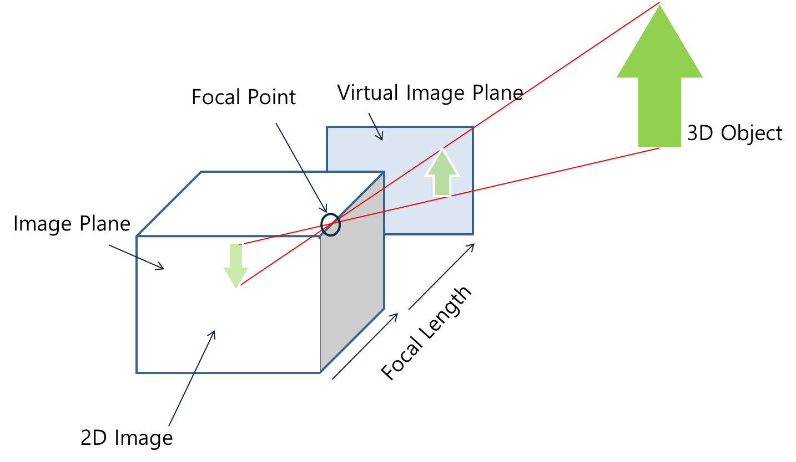
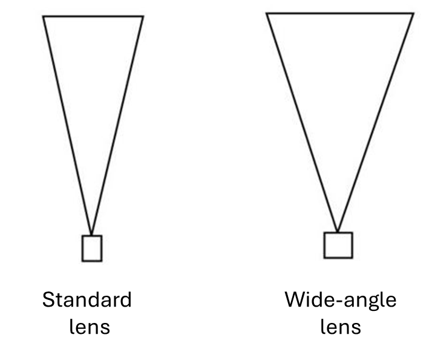
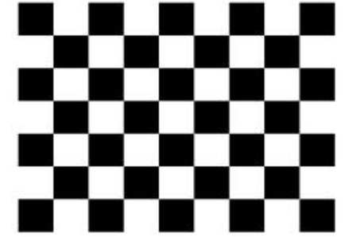
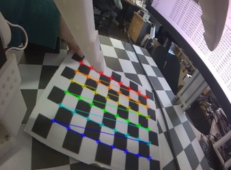
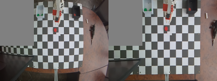
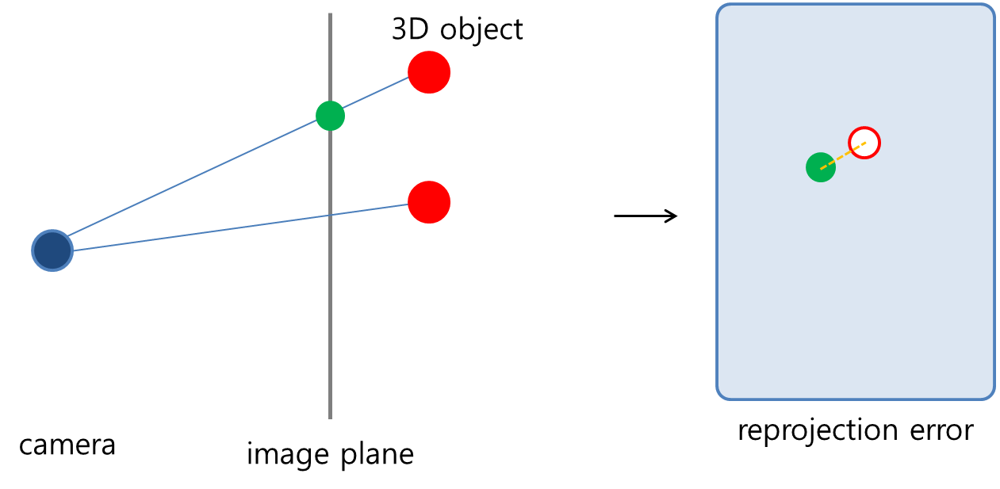

# Camera Calibration

카메라 캘리브레이션(Camera Calibration)은 **3차원 공간의 점이 카메라 이미지의 2차원 좌표로 투영되는 기하 관계를 모델링**하는 과정입니다. 이렇게 얻은 결과는 수학적 변환 모델로 나타나며 카메라 렌즈 왜곡, 초점 거리, 영상 중심점 등을 포괄합니다.



이 모델은 3D 세계 좌표를 2D 이미지 좌표로 투영하거나, 깊이 정보가 있을 때 2D 이미지 좌표를 3D 좌표로 역투영하는 데 사용됩니다. 다만 2D 이미지 좌표만으로 3D 세계 좌표를 유일하게 복원하려면 깊이 정보나 외부 파라미터 같은 추가 정보가 필요합니다. 카메라 캘리브레이션은 카메라 영상의 왜곡을 보정하고 이미지 좌표와 실제 공간 좌표 사이의 관계를 추정하는 과정입니다.

## 렌즈 왜곡

카메라 캘리브레이션을 수행하는 가장 대표적인 이유는 **렌즈 왜곡** 때문입니다. 실제 카메라는 완벽한 핀홀 카메라가 아닙니다. 이로 인해 직선이 휘어 보이고 이미지 좌표가 실제 투영 위치와 달라져 거리나 각도 계산이 틀어질 수 있습니다. 따라서 카메라 렌즈 특성과 왜곡, 위치 관계를 수학적으로 추정해야 합니다.

PhysicAI Arm 장비의 Follower arm 위에 장착된 카메라를 살펴보겠습니다. 이 카메라는 화각이 160도인 fisheye 렌즈입니다. 광각 렌즈의 경우 아래 사진처럼 표준 렌즈보다 더 넓은 범위를 촬영할 수 있습니다. 다만 화각이 넓은 광각 렌즈에서는 영상 주변부에서 직선이 바깥쪽으로 휘어 보이는 **배럴 왜곡(Barrel Distortion)** 현상이 발생하기 쉽습니다. 중심부보다 주변부에서 왜곡이 더 크게 나타나며, 이를 보정해 주지 않으면 이미지에서 측정한 위치와 실제 공간 위치 사이에 오차가 생겨 데이터셋 수집 과정에서 품질 좋은 데이터를 수집하기가 어려워집니다.



## 캘리브레이션

이제 PhysicAI Arm Camera를 사용해 실제 캘리브레이션 작업을 진행해 보겠습니다. 카메라 캘리브레이션은 Python과 OpenCV를 활용하여 진행합니다. 해당 패키지에 관한 자세한 정보는 아래 사이트를 참고해 주시기 바랍니다. 본 교재의 PhysicAI Arm 실습 환경에는 이미 설치되어 있으므로 따로 준비할 필요는 없습니다.

- https://www.python.org/
- https://opencv.org/

카메라 캘리브레이션을 통해 대표적으로 다음 두 가지를 얻을 수 있습니다.

1. Intrinsic Parameters(내부 파라미터)
카메라 내부 파라미터는 3D 점을 이미지 평면으로 투영할 때 사용하는 초점 거리와 영상 중심점 등을 나타냅니다.

```math
K =
\begin{bmatrix}
f_x & 0 & c_x \\
0 & f_y & c_y \\
0 & 0 & 1
\end{bmatrix}
```

- $f_x, f_y$: x축/y축 방향의 픽셀 단위 초점 거리
- $c_x, c_y$: 주점(principal point), 보통 영상 중심 근처에 위치

2. Distortion Coefficients(왜곡 계수)
렌즈 왜곡 정보를 나타내는 값입니다.
- Radial distortion: 배럴 왜곡, 핀쿠션 왜곡
- Tangential distortion: 렌즈와 이미지 센서가 정렬되지 않아 발생하는 왜곡

OpenCV에서는 보통

```math
(k_1, k_2, p_1, p_2, k_3)
```

의 형태로 사용합니다.

### 체커보드

OpenCV에서는 캘리브레이션에 주로 체커보드를 사용합니다. 평면 체커보드를 이용한 대표적인 캘리브레이션 방법은 1998년에 발표된 [Zhang의 논문](https://www.microsoft.com/en-us/research/wp-content/uploads/2016/02/tr98-71.pdf)으로 널리 알려졌습니다. 패턴이 뚜렷해 쉽게 감지할 수 있고, 각 사각형 코너들은 서로 다른 방향으로 급격한 기울기를 가지므로 위치 파악에 이상적입니다. 이로 인해 현재까지도 많이 사용되고 있습니다.

캘리브레이션 작업을 위해 아래 9x7 형태의 체커보드 이미지를 다운로드한 뒤 출력합니다. 캘리브레이션 작업에는 9x7칸(checker squares) 체커보드를 사용합니다. 9x7칸 체커보드는 내부 코너가 8x6개입니다. OpenCV의 `cv.findChessboardCorners()`에는 사각형 수가 아니라 내부 코너 수를 넣어야 하므로, 이 경우 'CHECKERBOARD=(8, 6)'으로 설정합니다.

[이미지 다운로드](/Chapter07.%20AI%20Overview/pds/checkerboard9x7.png)



### 전체 흐름

**1. 체커보드를 여러 각도에서 촬영**

카메라 캘리브레이션 작업을 진행하기 전, 체커보드 이미지를 준비해야 합니다. 카메라에서 최소 30cm 이상 떨어진 위치에서 체커보드 이미지를 촬영합니다.

현재 사용 중인 PhysicAI Arm의 카메라는 End Device(온보드 컴퓨터)와 CSI 케이블로 연결되어 있습니다. 카메라 영상을 불러오기 위해서는 GStreamer 패키지를 활용하여 호출해야 하며, 지금 쓰고 있는 파이프라인은 아래와 같습니다.

```sh
nvarguscamerasrc sensor-id={sensor_id} !
video/x-raw(memory:NVMM), width=1280, height=720, framerate=60/1, format=NV12 !
nvvidconv flip-method=0 !
video/x-raw, width=640, height=480, format=BGRx !
videoconvert !
video/x-raw, format=BGR !
appsink max-buffers=1 drop=true sync=false
```

- https://gstreamer.freedesktop.org/

실제 라이브 스트림 해상도는 640x480(bgr8)입니다. 이 카메라는 공식 스펙상 화각 160도의 광각 렌즈이므로, 이후 캘리브레이션은 어안(fisheye) 모델로 진행합니다.

체커보드를 다양한 위치와 각도로 옮겨 가며 최소 15장에서 30장 정도의 사진을 찍습니다. 표시되는 GUI에서 's' 키를 누르면 이미지가 저장됩니다. 자동으로 이미지를 캡쳐하고 싶다면 'a'를 눌러 오토 모드로 전환해줍니다. `cv2.imwrite` 명령어는 이미지를 캡처한 후 디스크에 저장합니다. 사진을 저장할 경로는 임의로 변경해도 무관합니다. 이 예제에서는 촬영한 체커보드 이미지를 `calib_<camera>/` 폴더에 저장한다고 가정합니다. 다른 경로를 사용할 경우 코드의 `glob.glob(...)` 경로도 함께 수정해야 합니다.

**2. 코너 검출**

캘리브레이션 진행을 위해 체커보드의 코너를 찾습니다. `cv2.findChessboardCorners()` 명령어를 이용하여 코너를 찾을 수 있습니다. 촬영된 사진들을 불러와 아래 두 종류의 좌표를 찾습니다.

- objpoints: 각 이미지에서 동일한 패턴 점의 3D 좌표
- imgpoints: 각 이미지에서 검출된 2D 코너 좌표

objpoints는 체커보드 좌표계에서 정의한 3D 기준점입니다. imgpoints는 `cv2.findChessboardCorners()` 함수에서 추출된 코너들을 `cv2.cornerSubPix`를 통해 보정한 뒤 저장합니다. Fisheye 캘리브레이션은 objpoints/imgpoints를 배열 형태로 한 단계 더 감싸는 형식(shape(1, N, 3))을 요구합니다.



**3. 카메라 행렬 및 왜곡 계수 추출**

`cv2.fisheye.calibrate` 함수를 사용하여 카메라 행렬(K)과 왜곡 계수(D), 각 이미지의 외부 파라미터를 추정합니다. 일반 `cv2.calibrateCamera`와 달리, fisheye 모델은 방사형 왜곡이 매우 큰 광각 렌즈를 위한 등거리(equidistant) 투영을 가정하기 때문에 160도급 렌즈에서 훨씬 안정적으로 왜곡을 보정합니다.

`rvecs` 및 `tvecs`는 각 촬영 이미지의 외부 파라미터(회전 벡터, 이동 벡터)입니다. 이후 `cv2.fisheye.estimateNewCameraMatrixForUndistortRectify`로 왜곡 보정 시 사용할 새 카메라 행렬을 계산합니다. `balance` 매개변수를 이용해 시야 유지 범위와 검정 여백도 조절할 수 있습니다.

**4. 이미지 비교**

이제 캘리브레이션을 적용한 이미지와 적용하지 않은 이미지를 비교해 가며 차이를 확인해 보겠습니다. `cv2.fisheye.initUndistortRectifyMap`으로 remap 좌표를 만들고 `cv2.remap`으로 원본 이미지를 보정합니다. 캘리브레이션을 적용하면 원본 이미지보다 왜곡이 크게 줄어든 것을 확인할 수 있습니다.

 

과정이 모두 끝나면 캘리브레이션 결과는 `out` 파라미터로 지정한 YAML 파일에 저장됩니다. 이 파일에는 이미지 크기(`image_width`, `image_height`), 카메라 행렬(`camera_matrix`), 왜곡 모델(`distortion_model`: fisheye는 `equidistant`, pinhole은 `plumb_bob`), 왜곡 계수(`distortion_coefficients`), 그리고 `balance`를 반영해 계산한 새 카메라 행렬이 담긴 `projection_matrix`가 들어 있습니다. 카메라마다 별도의 YAML 파일이 만들어지며, 이 파일들을 이용하여 추후 로봇 학습(`parsing_node`의 `TOP_CALIB_PATH`/`FRONT_CALIB_PATH`)과 실시간 추론(`inference_node`의 `top_calib_path`/`front_calib_path`) 양쪽에 동일하게 이미지 왜곡 보정을 적용할 수 있습니다. 두 노드는 기본적으로 실행 위치(workspace)의 `top_camera_calib.yaml`, `front_camera_calib.yaml`을 읽으므로, 아래 명령어처럼 workspace에서 같은 파일 이름으로 저장하면 경로를 따로 바꿀 필요가 없습니다. 학습과 추론 중 한쪽에만 적용하면 학습-추론 불일치 문제가 발생하니, 반드시 양쪽에 같은 캘리브레이션 파일을 일관되게 적용해야 합니다.

### 원리

카메라 캘리브레이션의 핵심 원리는 실제 공간에서 알고 있는 점의 위치와 카메라 이미지에서 관찰되는 점의 위치를 비교하여 두 좌표 사이의 관계를 가장 정확하게 설명하는 카메라 파라미터를 찾는 것입니다.

카메라는 3차원 공간의 물체를 2차원 이미지로 변환합니다. 이 과정에서는 원근 투영이 발생합니다. 같은 크기의 물체라도 카메라에 가까이 있으면 크게 보이고, 멀리 있으면 작게 보이는 현상이 대표적인 예입니다.

**1. 3차원 좌표의 2차원 투영**

카메라를 기준으로 공간에 존재하는 점의 좌표를 ((X, Y, Z)) 라고 가정합니다. 여기서 (X)와 (Y)는 카메라를 기준으로 한 수평 및 수직 방향의 위치이고, (Z)는 카메라로부터의 깊이를 나타냅니다. 

이 점이 이미지에 투영되는 위치는 다음과 같은 기본적인 관계로 표현할 수 있습니다.

```math
[x=\frac{X}{Z},\qquad y=\frac{Y}{Z}]

```

이 식에서 (x, y)는 정규화된 이미지 좌표입니다. 물체의 깊이 (Z)가 커질수록 (x, y)의 절대값이 작아지므로 물체가 이미지 중심에 가까워지는 원근 효과가 발생합니다.

실제 픽셀 좌표를 계산하려면 카메라의 초점 거리와 주점을 반영해야 합니다.

```math
[
    u=f_x\frac{X}{Z}+c_x
]

[
    v=f_y\frac{Y}{Z}+c_y
]

```

여기서 ((u,v))는 이미지에서의 픽셀 좌표입니다.

예를 들어 같은 물체가 카메라에서 30cm 떨어져 있을 때와 60cm 떨어져 있을 때를 비교하면, 물체의 수평 및 수직 위치가 동일하더라도 이미지 중심으로부터의 픽셀 거리는 달라집니다.

이러한 관계를 이용하면 공간상의 점이 이미지의 어느 위치에 나타날지 수학적으로 예측할 수 있습니다.

다만 위 식은 렌즈 왜곡을 고려하지 않은 기본적인 핀홀 카메라 모델입니다. 실제 PhysicAI Arm에 사용되는 어안 렌즈에서는 광선이 이미지에 투영되는 각도에 따른 왜곡을 추가로 반영해야 합니다.

**2. 어안 렌즈의 투영 원리**

일반적인 핀홀 카메라 모델은 깊이(Z)를 이용하여 점의 투영 위치를 계산합니다. 반면 어안 렌즈 모델은 카메라의 광축과 물체를 향하는 광선 사이의 각도 (\theta)를 이용하여 투영 위치를 설명합니다.

OpenCV의 fisheye 모델에서는 다음과 같은 관계를 사용합니다.

```math
[
    r=\sqrt{x^2+y^2}
]

[
    \theta=\arctan(r)
]

```

여기서 (r)은 정규화된 이미지 좌표의 중심으로부터의 거리이며, (\theta)는 광축과 광선 사이의 각도입니다.

실제 렌즈의 왜곡을 반영하기 위해 다음 식을 적용합니다.

```math
[
    \theta_d=\theta(1+k_1\theta^2+k_2\theta^4+k_3\theta^6+k_4\theta^8)
]
```

여기서 ( $k_1$, $k_2$, $k_3$, $k_4$)는 어안 렌즈의 왜곡 계수입니다.

왜곡이 반영된 각도 (\theta_d)를 이용하여 이미지 좌표를 계산하면 다음과 같습니다.

```math
[
    x'=\frac{\theta_d}{r}x,\qquad
    y'=\frac{\theta_d}{r}y
]
```

이후 카메라 내부 파라미터를 적용하여 최종 픽셀 좌표를 구합니다. 단 (r=0)인 경우에는 중심점의 극한값을 사용합니다.

이처럼 어안 렌즈 캘리브레이션은 광선의 입사 각도에 따른 투영 특성을 모델링하여, 영상 중심부와 주변부에서 서로 다르게 발생하는 왜곡을 수학적으로 표현합니다.

**3. 재투영 오차(Reprojection Error)**



앞의 캘리브레이션 과정에서 체커보드 코너를 검출하고 카메라 파라미터를 계산했습니다. 그렇다면 계산한 파라미터가 얼마나 정확한지는 어떻게 판단할 수 있을까요?

이를 확인하기 위해 **재투영 오차**를 사용합니다.

재투영이란 실제 공간에서 알고 있는 3차원 점을 추정된 카메라 모델에 입력하여 해당 점이 이미지의 어느 위치에 나타날 지 다시 계산하는 과정입니다.

예를 들어 체커보드의 특정 코너가 실제 이미지에서 ((250, 180)) 픽셀로 검출되었지만, 추정된 카메라 모델에서는 ((253, 184))픽셀로 계산되었다고 가정합니다.

두 좌표 사이의 차이는 다음과 같이 계산할 수 있습니다.

```math
[
    e=\sqrt{(250-253)^2+(180-184)^2}
]

[
    e=5\text{ pixels}
]

```

즉 해당 코너의 재투영 오차는 5픽셀 입니다.

실제 캘리브레이션에서는 하나의 코너가 아니라 모든 촬영 이미지에서 검출한 코너의 재투영 오차를 계산합니다.

**4. 최적화(Optimization)**

캘리브레이션 알고리즘은 계산된 재투영 오차가 최소가 되도록 카메라 파라미터를 반복적으로 조정합니다.

이 과정에서 초점 거리, 주점, 왜곡 계수, 각 이미지에서의 체커보드 자세 등을 함께 추정합니다.

대표적으로 다음과 같은 목적 함수를 최소화합니다.

```math
[
    E=\sum_{i=1}^{N}
    \left|
        p_i-\hat{p}_i
        \right|^2

]
```

- (N) : 전체 코너 관측 개수
- ($p_i$) : 실제 이미지에서 검출된 코너 좌표
- ($\hat{p}_i$) : 카메라 모델을 통해 예측한 코너 좌표
- (E) : 전체 재투영 오차의 제곱합

알고리즘은 이 값이 작아지는 방향으로 파라미터를 조정하고, 최종적으로 관측된 이미지와 가장 잘 일치하는 카메라 모델을 구합니다.

단, 재투영 오차가 적다고 해서 모든 공간 좌표 계산이 정확하다는 얘기는 아닙니다. 체커보드의 인쇄 정확도, 촬영 각도의 다양성, 코너 검출 품질 등에 따라서도 실제 보정 정확도가 달라질 수 있습니다.

이러한 과정을 통해 구한 카메라 파라미터는 이후 영상의 왜곡을 보정하거나 공간 상의 점을 이미지로 투영하는 작업에 활용됩니다.


### 전체 코드

[전체 코드](/etc/calibration_node.py)는 ROS 2 토픽 `/arm/top_cam`이나 `/arm/front_cam`으로 들어오는 카메라 영상을 사용합니다.

`/arm/top_cam` 토픽을 사용하여 top 카메라를 캘리브레이션하고 싶다면 아래 명령어를 통해 파일을 실행하면 됩니다.

```sh
ros2 run physicai_arm calibration_node --ros-args -p topic:=/arm/top_cam -p save_dir:=top_calib_images -p out:=top_camera_calib.yaml -p camera_name:=top_cam -p square:=0.025
```


`/arm/front_cam` 토픽을 사용하여 front 카메라를 캘리브레이션하고 싶다면 아래 명령어를 통해 파일을 실행하면 됩니다.

```sh
ros2 run physicai_arm calibration_node --ros-args -p topic:=/arm/front_cam -p save_dir:=front_calib_images -p out:=front_camera_calib.yaml -p camera_name:=front_cam -p square:=0.025
```

----

## 복습 퀴즈

1. 카메라 캘리브레이션은 무엇을 모델링하는 과정인가?

<br>

2. 2D 이미지 좌표만으로 3D 세계 좌표를 유일하게 복원하기 어려운 이유는 무엇인가?

<br>

3. 광각 렌즈에서 배럴 왜곡이 발생하면 이미지가 어떻게 보이는가?

<br>

4. 렌즈 왜곡을 보정하지 않으면 로봇 학습 데이터 품질에 어떤 문제가 생길 수 있는가?

<br>

5. Intrinsic Parameters는 무엇을 나타내는가?

<br>

6. Distortion Coefficients는 무엇을 나타내는가?

<br>

7. Radial distortion과 Tangential distortion의 차이를 설명하시오.

<br>

8. 카메라 캘리브레이션에 체커보드를 많이 사용하는 이유는 무엇인가?

<br>

9. 9x7칸 체커보드를 `CHECKERBOARD=(8,6)`으로 설정하는 이유는 무엇인가?

<br>

10. objpoints와 imgpoints의 차이는 무엇인가?

<br>

11. 아래 함수가 무엇을 의미하는지 작성하시오. 
<br>
a. cv2.findChessboardCorners() 
<br>
b. cv2.cornerSubPix() 
<br>
c. cv2.fisheye.calibrate() 
<br>
d. cv2.fisheye.estimateNewCameraMatrixForUndistortRectify() 
<br>
e. cv2.fisheye.initUndistortRectifyMap()와 cv2.remap()

<br>

12. 캘리브레이션 결과를 YAML 파일로 저장해 두면 다음 실습에서 어떻게 활용할 수 있는가?

<br>

13. 캘리브레이션 이미지가 한 방향, 한 거리에서만 촬영되면 어떤 문제가 생길 수 있는가?

