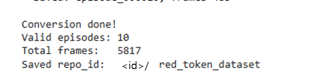

# Google Colab

Google Colab은 Jupyter Notebook 환경을 웹브라우저에서 사용할 수 있도록 Google에서 제공하는 클라우드 기반 개발 플랫폼입니다. 별도의 Python 환경을 설치하지 않고도 브라우저에서 바로 Python 코드를 실행할 수 있는 서비스입니다.

1. 설치 없이 이용 가능
일반적으로 Python 개발을 하려면 Python 설치, 가상환경 생성, 라이브러리 설치, CUDA 설치 등이 필요하지만 Colab은 브라우저만 있으면 Python 코드를 바로 실행할 수 있습니다.

2. GPU 사용 가능
딥러닝 학습에 필요한 GPU를 무료 또는 유료 플랜으로 사용할 수 있습니다. 본 교재의 Chapter8 예제는 무료 플랜에서도 실행할 수 있도록 구성되어 있지만, GPU 할당 여부와 사용 시간은 Colab 정책과 계정 상태에 따라 달라질 수 있습니다.

3. Jupyter Notebook 기반
코드를 셀 단위로 실행합니다.

4. Google Drive 연동
구글 드라이브를 마운트하여 파일을 읽고 저장할 수 있습니다.

5. AI/딥러닝 라이브러리 기본 제공
NumPy, PyTorch 등 주요 AI/딥러닝 라이브러리가 기본 제공되며, 필요한 패키지는 추가로 설치할 수 있습니다.

## 사전 준비

Colab을 이용하기 위해선 Google 계정이 필요합니다. 계정에 로그인한 뒤, Google Colab을 검색하여 들어갑니다.


Google Colab에 들어가면 아래와 같은 창이 뜹니다. `New notebook`을 클릭하여 새 노트북을 열어줍니다.


새 노트북을 열면 아래와 같은 창이 열립니다. 자주 사용하는 버튼을 설명하겠습니다. `1`에서는 파일명을 변경할 수 있고 `2`에서 코드를 입력합니다. `3`은 파일 패널이며, 여기에서 현재 런타임 파일을 확인하거나 Google Drive를 마운트할 수 있습니다. Google Drive를 마운트를 하지 않고 `/content` 아래에만 저장한 파일은 런타임이 초기화되거나 종료될 때 사라질 수 있습니다.


다음으로 학습을 위한 runtime을 설정하겠습니다. 기본적으로 CPU로 설정되어 있어 이를 GPU로 변경합니다. Runtime > Change runtime type 을 클릭합니다.


Change runtime type 창이 뜨면, Hardware accelerator를 GPU로 설정하고, 사용 가능한 경우 T4 GPU를 선택한 뒤 저장합니다.


## 활용

Dataset Parsing과 Training은 PhysicAI ARM의 Jetson 환경에서도 가능합니다. 하지만 조금 더 빠른 속도를 위해 Google Colab을 사용할 수 있습니다.

### Parsing

데이터 수집이 완료된 파일을 Colab에 업로드하기 위해 압축합니다. 

```sh
zip -r dataset_raw.zip dataset_raw
```

해당 파일을 Google Drive에 업로드합니다. FireFox를 이용하여 구글에 접속한 뒤, 로그인을 하여 이용할 수 있습니다. 본격적으로 시작하기에 앞서, 구글 드라이브 마운트를 진행하겠습니다.

```sh
from google.colab import drive
drive.mount('/content/drive')
```
드라이브를 마운트한 뒤, 제대로 마운트되었는지 폴더에서 확인합니다. 확인이 되었으면 아까 업로드했던 파일의 압축을 푼 뒤, parsing을 시작하겠습니다.
```python
import zipfile

zip_path = "/content/drive/MyDrive/dataset_raw.zip"
extract_path = "/content"

with zipfile.ZipFile(zip_path, "r") as zip_ref:
    zip_ref.extractall(extract_path)
```

데이터 parsing을 진행하기 위해선 'lerobot'과 'huggingface' 패키지가 필요합니다. Colab에 해당 패키지를 설치하겠습니다.

```sh
!pip install --upgrade pip
!pip install -q "lerobot==0.4.4"
!pip install -q huggingface_hub
```

설치한 후, huggingface에 업로드하기 위한 계정에 로그인하겠습니다. 보안상의 이유로 colab의 secret key 기능을 사용하겠습니다. 아래와 같이 클릭하여 secret 섹션으로 들어가 주시기 바랍니다. Name에는 `HF_TOKEN`을 입력해주고 Value에는 huggingface에서 발급받은 API key를 입력하시기 바랍니다.


다시 코드로 돌아와서 huggingface 로그인을 진행하겠습니다.

```py
from huggingface_hub import login
from google.colab import userdata

token = userdata.get('HF_TOKEN')
login(token=token)
```

로그인을 진행한 뒤, 압축을 푼 원시 데이터 파일을 이용해 parsing을 진행하겠습니다.

<details>
<summary> parsing 코드</summary>

```py
import csv
import json
import shutil
from pathlib import Path
from lerobot.datasets.lerobot_dataset import LeRobotDataset
import cv2
import numpy as np
import torch


RAW_ROOT = Path("/content/dataset_raw")
OUT_REPO_ID = "<id>/red_token_dataset"

FPS = 20
IMAGE_SIZE = (128, 128)
TOP_CROP_SIZE = (128, 128)

MAX_TIME_DIFF = 0.06

TASK_DEFAULT = "pick_red_token"


def image_time_from_path(path):
    try:
        return float(path.stem.split("_")[-1])
    except Exception:
        return None


def build_timed_images(image_paths):
    timed = []
    for path in image_paths:
        t = image_time_from_path(path)
        if t is None or t <= 0.0:
            continue
        timed.append((t, path))
    timed.sort(key=lambda x: x[0])
    return timed


def read_csv_dict(path):
    with open(path, "r", newline="") as f:
        return list(csv.DictReader(f))


def safe_float(row, key, default=0.0):
    try:
        value = row.get(key, default)
        if value is None or value == "":
            return default
        return float(value)
    except Exception:
        return default


def get_row_time(row, fallback_index=None):
    for key in ["timestamp", "time", "t", "stamp"]:
        if key in row:
            return safe_float(row, key)
    if "sec" in row and "nanosec" in row:
        return safe_float(row, "sec") + safe_float(row, "nanosec") * 1e-9
    if "secs" in row and "nsecs" in row:
        return safe_float(row, "secs") + safe_float(row, "nsecs") * 1e-9
    if fallback_index is not None:
        return fallback_index / FPS
    return None


def row_to_state(row):
    keys = [
        "joint_0", "joint_1", "joint_2",
        "joint_3", "joint_4", "joint_5",
    ]
    return np.array([safe_float(row, k) for k in keys], dtype=np.float32)


def row_to_action_target(row):
    keys = [
        "target_joint_0", "target_joint_1", "target_joint_2",
        "target_joint_3", "target_joint_4", "target_joint_5",
    ]
    return np.array([safe_float(row, k) for k in keys], dtype=np.float32)


def load_top_image(path):
    img = cv2.imread(str(path))

    if img is None:
        img = np.zeros((TOP_CROP_SIZE[1], TOP_CROP_SIZE[0], 3), dtype=np.uint8)
    else:

        h, w = img.shape[:2]
        x_start = w // 3
        img = img[:, x_start:]
        img = cv2.resize(img, TOP_CROP_SIZE)

    img = cv2.cvtColor(img, cv2.COLOR_BGR2RGB)
    return img


def load_front_image(path):
    img = cv2.imread(str(path))

    if img is None:
        img = np.zeros((IMAGE_SIZE[1], IMAGE_SIZE[0], 3), dtype=np.uint8)
    else:
        img = cv2.resize(img, IMAGE_SIZE)

    img = cv2.cvtColor(img, cv2.COLOR_BGR2RGB)
    return img


def get_task_name(episode_path):
    metadata_path = episode_path / "metadata.json"
    if not metadata_path.exists():
        return TASK_DEFAULT
    try:
        with open(metadata_path, "r") as f:
            metadata = json.load(f)
        task_name = metadata.get("task_name", TASK_DEFAULT)
        if task_name == "pick_red_token":
            return TASK_DEFAULT
        return task_name
    except Exception:
        return TASK_DEFAULT


def get_success(episode_path):
    metadata_path = episode_path / "metadata.json"
    if not metadata_path.exists():
        return True
    try:
        with open(metadata_path, "r") as f:
            metadata = json.load(f)
        success = metadata.get("success", True)
        return success is not False
    except Exception:
        return True


def remove_old_output():
    cache_path = Path.home() / ".cache/huggingface/lerobot" / OUT_REPO_ID
    if cache_path.exists():
        shutil.rmtree(cache_path)
        print(f"Removed old output: {cache_path}")


def build_timed_rows(rows):
    timed = []
    for i, row in enumerate(rows):
        t = get_row_time(row, fallback_index=i)
        if t is None:
            continue
        timed.append((t, row))
    timed.sort(key=lambda x: x[0])
    return timed


def nearest_by_time(timed_data, target_time, start_index=0):
    if not timed_data:
        return None, start_index, None

    idx = start_index

    while idx + 1 < len(timed_data):
        now_diff = abs(timed_data[idx][0] - target_time)
        next_diff = abs(timed_data[idx + 1][0] - target_time)

        if next_diff <= now_diff:
            idx += 1
        else:
            break

    matched_time, matched_value = timed_data[idx]
    diff = abs(matched_time - target_time)

    return matched_value, idx, diff


def main():
    remove_old_output()

    features = {
        "observation.images.top": {
            "dtype": "image",
            "shape": (TOP_CROP_SIZE[1], TOP_CROP_SIZE[0], 3),
            "names": ["height", "width", "channel"],
        },
        "observation.images.front": {
            "dtype": "image",
            "shape": (IMAGE_SIZE[1], IMAGE_SIZE[0], 3),
            "names": ["height", "width", "channel"],
        },
        "observation.state": {
            "dtype": "float32",
            "shape": (6,),
            "names": ["state"],
        },
        "action": {
            "dtype": "float32",
            "shape": (6,),
            "names": ["action"],
        },
    }

    dataset = LeRobotDataset.create(
        repo_id=OUT_REPO_ID,
        fps=FPS,
        features=features,
    )

    episode_paths = sorted(RAW_ROOT.glob("episode_*"))

    print(f"Found {len(episode_paths)} raw episodes")
    print(f"top image size: {TOP_CROP_SIZE[0]}x{TOP_CROP_SIZE[1]} (w x h)")
    print(f"front image size: {IMAGE_SIZE[0]}x{IMAGE_SIZE[1]} (w x h)")

    valid_episode_count = 0
    total_frame_count = 0

    for episode_path in episode_paths:
        if not episode_path.is_dir():
            continue

        if not get_success(episode_path):
            print(f"Skip failed episode: {episode_path}")
            continue

        states_csv = episode_path / "states.csv"
        actions_csv = episode_path / "actions.csv"
        top_dir = episode_path / "images" / "top"
        front_dir = episode_path / "images" / "front"

        if not states_csv.exists():
            print(f"Skip: missing states.csv - {episode_path}")
            continue
        if not actions_csv.exists():
            print(f"Skip: missing actions.csv - {episode_path}")
            continue
        if not top_dir.exists():
            print(f"Skip: missing top image dir - {episode_path}")
            continue
        if not front_dir.exists():
            print(f"Skip: missing front image dir - {episode_path}")
            continue

        states = read_csv_dict(states_csv)
        actions = read_csv_dict(actions_csv)
        top_images = sorted(top_dir.glob("*.png"))
        front_images = sorted(front_dir.glob("*.png"))

        timed_top_images = build_timed_images(top_images)
        timed_front_images = build_timed_images(front_images)
        timed_states = build_timed_rows(states)
        timed_actions = build_timed_rows(actions)

        if not timed_states or not timed_actions or not timed_top_images or not timed_front_images:
            print(f"Skip empty episode: {episode_path}")
            continue

        task = get_task_name(episode_path)

        print(
            f"Processing {episode_path.name}: "
            f"states={len(timed_states)}, actions={len(timed_actions)}, "
            f"top={len(top_images)}, front={len(front_images)}"
        )

        state_idx = 0
        action_idx = 0
        top_idx = 0
        front_idx = 0
        added_count = 0

        for frame_time, state_row in timed_states:
            top_path,   top_idx,   top_diff   = nearest_by_time(timed_top_images,   frame_time, top_idx)
            front_path, front_idx, front_diff = nearest_by_time(timed_front_images, frame_time, front_idx)
            action_row, action_idx, act_diff  = nearest_by_time(timed_actions,      frame_time, action_idx)

            if any(d is None or d > MAX_TIME_DIFF for d in [top_diff, front_diff, act_diff]):
                continue

            if state_row is None or action_row is None:
                continue

            current_joint = row_to_state(state_row)
            target_joint  = row_to_action_target(action_row)

            top_img   = load_top_image(top_path)
            front_img = load_front_image(front_path)

            dataset.add_frame({
                "observation.images.top":   top_img,
                "observation.images.front": front_img,
                "observation.state":  torch.tensor(current_joint, dtype=torch.float32),
                "action":             torch.tensor(target_joint,  dtype=torch.float32),
                "task": task,
            })

            total_frame_count += 1
            added_count       += 1

        if added_count == 0:
            print(f"Skip save: no valid frames - {episode_path}")
            continue

        dataset.save_episode()
        valid_episode_count += 1

        print(f"  Saved: {episode_path.name}, frames={added_count}")

    print("\nConversion done!")
    print(f"Valid episodes: {valid_episode_count}")
    print(f"Total frames:   {total_frame_count}")
    print(f"Saved repo_id:  {OUT_REPO_ID}")


if __name__ == "__main__":
    main()
```

</details>


파싱이 완료되면 아래와 같은 문구가 뜹니다. 



### Training

파싱이 완료되었으면 학습을 진행하겠습니다.

```py
!lerobot-train \
  --dataset.repo_id=<id>/red_token_dataset \
  --policy.type=act \
  --output_dir=outputs/train/pick_red_token \
  --steps=10000 \
  --num_workers=8 \
  --batch_size=16 \
  --job_name=pick_red_token \
  --policy.repo_id=<id>/pick_red_token \
  --policy.device=cuda \
  --wandb.enable=false
```

학습 모델이 huggingface에 정상적으로 업로드되지 않았으면 아래 명령어를 입력하고 실행해주시기 바랍니다.

```py
from huggingface_hub import create_repo, upload_folder

create_repo(
    repo_id="<id>/pick_red_token",
    repo_type="model",
    exist_ok=True,
)

upload_folder(
    repo_id="<id>/pick_red_token",
    repo_type="model",
    folder_path="outputs/train/pick_red_token/checkpoints/last/pretrained_model",
)
```


또한 데이터 통계 파일도 빠르게 생성하기 위해서 colab에서 진행하겠습니다. 아래 명령어를 입력하고 실행해주시기 바랍니다. \<id>에는 본인의 huggingface ID를 입력해주시기 바랍니다.

```py
import json
import torch
from pathlib import Path
from lerobot.datasets.lerobot_dataset import LeRobotDataset

ds = LeRobotDataset("<id>/red_token_dataset")

states = []
actions = []

for i in range(len(ds)):
    frame = ds[i]
    states.append(frame["observation.state"])
    actions.append(frame["action"])

states = torch.stack(states).float()
actions = torch.stack(actions).float()

stats = {
    "state_mean": states.mean(dim=0).tolist(),
    "state_std": states.std(dim=0).tolist(),
    "action_mean": actions.mean(dim=0).tolist(),
    "action_std": actions.std(dim=0).tolist(),
    "action_min": actions.min(dim=0).values.tolist(),
    "action_max": actions.max(dim=0).values.tolist(),
}

with open("dataset_stats.json", "w") as f:
    json.dump(stats, f)

print(stats)
```

dataset_stats.json 파일을 구글 드라이브에 업로드 해줍니다. 그 후, Jetson 환경으로 돌아와 업로드했던 파일을 `/home/soda/physicai_arm_ws/src/physicai_arm/physicai_arm` 폴더에 복사해 줍니다.
