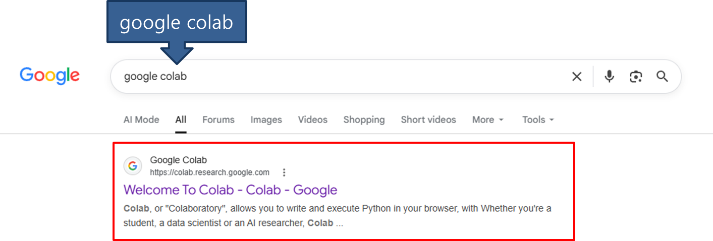
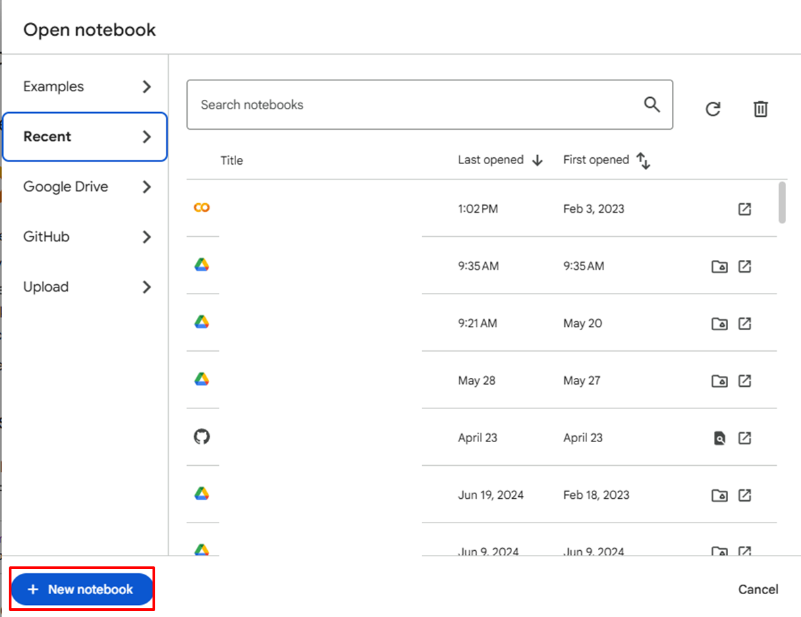
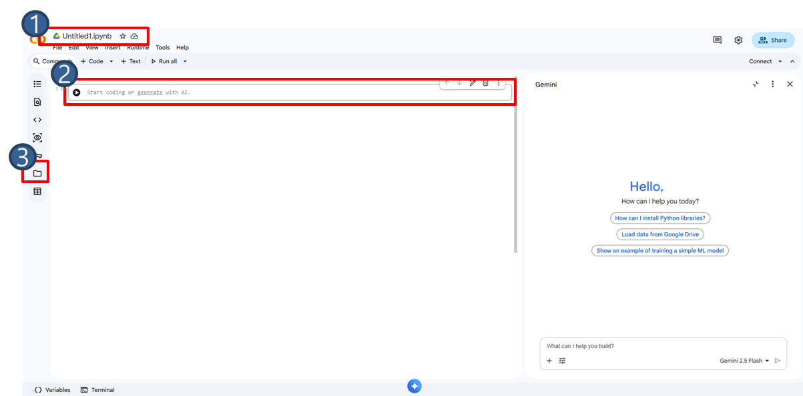
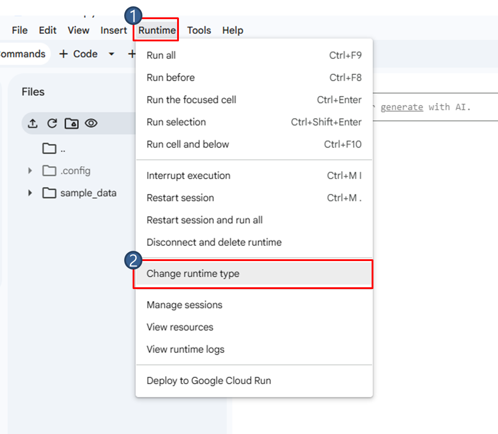
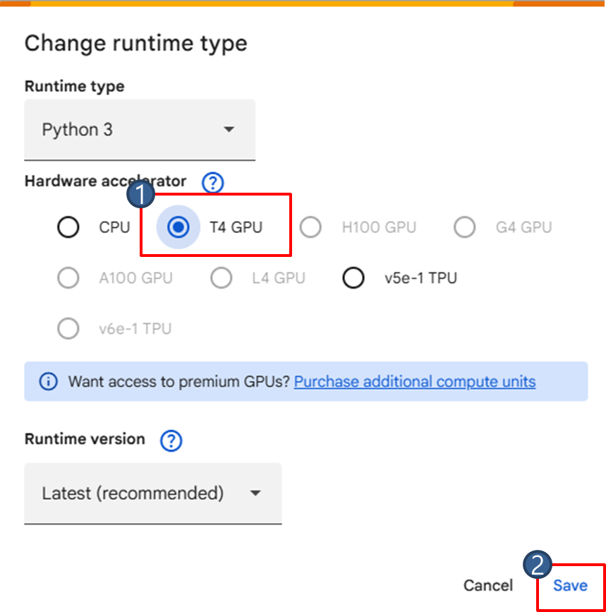
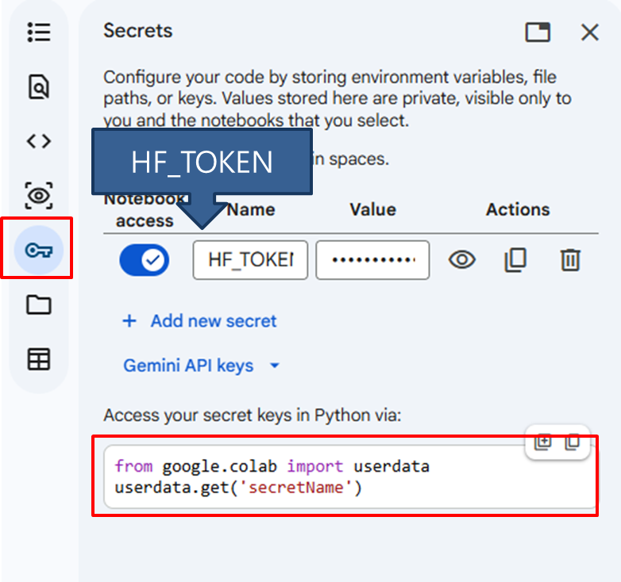

# Google Colab

Google Colab은 Jupyter Notebook 환경을 웹브라우저에서 사용할 수 있도록 Google에서 제공하는 클라우드 기반 개발 플랫폼입니다. 별도의 Python 환경을 설치하지 않고도 브라우저에서 바로 Python 코드를 실행할 수 있는 서비스입니다.

**1. 설치 없이 이용 가능**

일반적으로 Python 개발을 하려면 Python 설치, 가상환경 생성, 라이브러리 설치, CUDA 설치 등이 필요하지만 Colab은 브라우저만 있으면 Python 코드를 바로 실행할 수 있습니다.

**2. GPU 사용 가능**

딥러닝 학습에 필요한 GPU를 무료 또는 유료 플랜으로 사용할 수 있습니다. 본 교재의 Chapter 8 예제는 무료 플랜에서도 실행할 수 있도록 구성되어 있지만, GPU 할당 여부와 사용 시간은 Colab 정책과 계정 상태에 따라 달라질 수 있습니다.

**3. Jupyter Notebook 기반**

코드를 셀 단위로 실행합니다.

**4. Google Drive 연동**

구글 드라이브를 마운트하여 파일을 읽고 저장할 수 있습니다.

**5. AI/딥러닝 라이브러리 기본 제공**

NumPy, PyTorch 등 주요 AI/딥러닝 라이브러리가 기본 제공되며, 필요한 패키지는 추가로 설치할 수 있습니다.

## 사전 준비

Colab을 이용하기 위해선 Google 계정이 필요합니다. 계정에 로그인한 뒤, Google Colab을 검색하여 들어갑니다.



Google Colab에 들어가면 아래와 같은 창이 뜹니다. `New notebook`을 클릭하여 새 노트북을 열어줍니다.



새 노트북을 열면 아래와 같은 창이 열립니다. 자주 사용하는 버튼을 설명하겠습니다. `1`에서는 파일명을 변경할 수 있고 `2`에서 코드를 입력합니다. `3`은 파일 패널이며, 여기에서 현재 런타임 파일을 확인하거나 Google Drive를 마운트할 수 있습니다. Google Drive를 마운트하지 않고 `/content` 아래에만 저장한 파일은 런타임이 초기화되거나 종료될 때 사라질 수 있습니다.



다음으로 학습을 위한 runtime을 설정하겠습니다. 기본적으로 CPU로 설정되어 있어 이를 GPU로 변경합니다. Runtime > Change runtime type 을 클릭합니다.



Change runtime type 창이 뜨면, Hardware accelerator를 GPU로 설정하고, 사용 가능한 경우 T4 GPU를 선택한 뒤 저장합니다.



## 활용

데이터 파싱은 Jetson에서 `parsing_node`로 진행하며, 그 결과가 곧바로 Hugging Face Hub에 업로드됩니다([8-2. Dataset & Training](/Chapter08.%20Pick%20the%20Red%20Token/8-2.%20Dataset%20&%20Training.md) 참고). 이 절에서는 이미 업로드된 데이터셋을 그대로 불러와 **학습만** Google Colab에서 진행합니다. 학습도 Jetson에서 할 수 있지만, 더 빠른 GPU를 사용하기 위해 Colab을 이용합니다.

### 데이터셋 불러오기

학습에는 `lerobot`과 `huggingface_hub` 패키지가 필요합니다. Colab에 설치합니다.

```sh
!pip install --upgrade pip
!pip install -q "lerobot==0.4.4"
!pip install -q huggingface_hub
```

설치한 후, Hugging Face 계정에 로그인합니다. 보안상의 이유로 Colab의 secret key 기능을 사용하겠습니다. 아래와 같이 클릭하여 secret 섹션으로 들어가 주시기 바랍니다. Name에는 `HF_TOKEN`을 입력하고 Value에는 Hugging Face에서 발급받은 API key를 입력하시기 바랍니다. 학습 결과 모델도 업로드하므로 토큰은 **쓰기 권한**이 있어야 합니다.



다시 코드로 돌아와서 Hugging Face 로그인을 진행하겠습니다.

```python
from huggingface_hub import login
from google.colab import userdata

token = userdata.get('HF_TOKEN')
login(token=token)
```

학습 결과를 Google Drive에 저장하려면 드라이브를 마운트합니다. (필요 없으면 건너뛰어도 됩니다.)

```python
from google.colab import drive
drive.mount('/content/drive')
```

Jetson에서 파싱할 때 업로드한 데이터셋(`<id>/red_token_dataset`)은 `lerobot-train`이 `--dataset.repo_id` 값으로 Hub에서 자동으로 내려받으므로 별도의 다운로드나 압축 해제 과정이 필요 없습니다. `<id>`에는 본인의 Hugging Face 사용자명을 입력합니다.

### Training

데이터셋이 준비되었으면 학습을 진행하겠습니다. `--dataset.repo_id`에 Jetson에서 업로드한 데이터셋 저장소를 지정하면 Hub에서 자동으로 내려받아 학습합니다. Chapter 9·10 예제를 학습할 때는 `--dataset.repo_id`와 `--output_dir`, `--job_name`, `--policy.repo_id`를 해당 예제 값(`classify_tokens_dataset`, `stack_tokens_dataset` 등)으로 바꿉니다.

```python
!lerobot-train \
  --dataset.repo_id=<id>/<dataset_name> \
  --policy.type=act \
  --output_dir=outputs/train/<output_dir> \
  --steps=100000 \
  --num_workers=8 \
  --batch_size=16 \
  --job_name=<job_name> \
  --policy.repo_id=<id>/<policy_name> \
  --policy.device=cuda \
  --wandb.enable=false
```

학습 모델이 Hugging Face에 정상적으로 업로드되지 않았다면 아래 명령어를 입력하고 실행해 주시기 바랍니다.

```python
from huggingface_hub import create_repo, upload_folder

create_repo(
    repo_id="<id>/<policy_name>",
    repo_type="model",
    exist_ok=True,
)

upload_folder(
    repo_id="<id>/<policy_name>",
    repo_type="model",
    folder_path="outputs/train/<output_dir>/checkpoints/last/pretrained_model",
)
```

학습이 끝나면 `outputs/train/<output_dir>/checkpoints/last/pretrained_model` 폴더(Chapter 8 기준 `outputs/train/pick_red_token/...`)에 정책 가중치와 정규화 통계가 함께 저장됩니다. 추론 노드는 이 폴더만 있으면 되므로, 이 경로(또는 Hub에 업로드한 정책 저장소)를 `policy_path`에 지정해 사용합니다.
