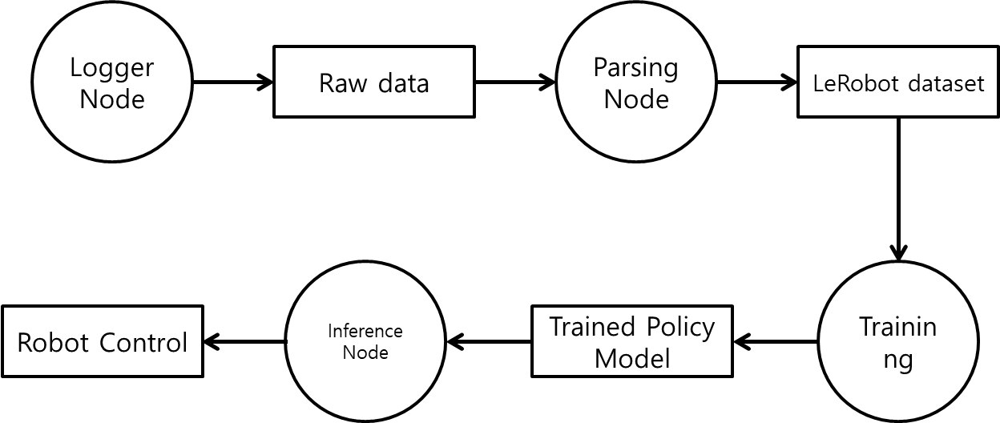
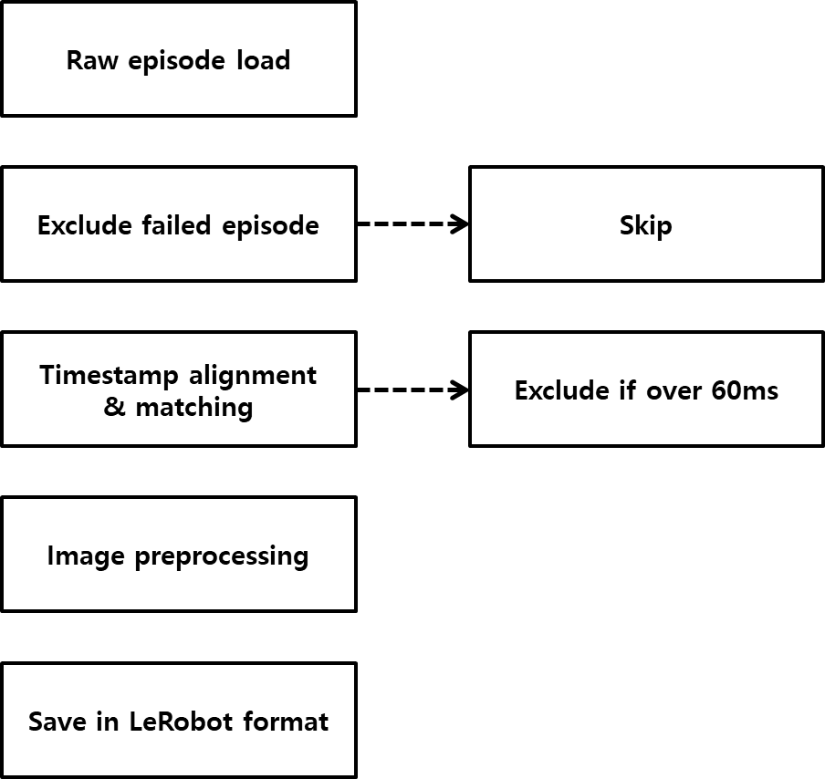
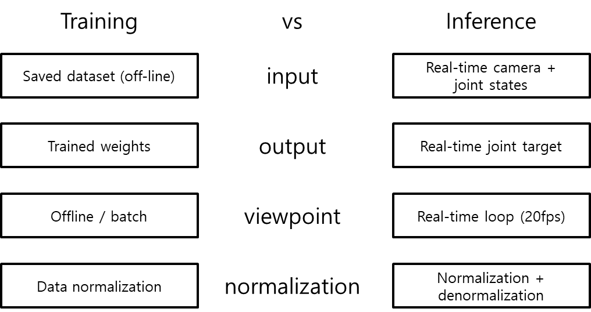

# Preparation

이번 장에서는 ROS 2에서 데이터를 수집하고, 이를 LeRobot 학습 데이터셋으로 변환한 뒤, 학습된 policy를 실제 로봇에서 실행하기 위한 준비 과정을 진행합니다. 학습은 직접 만든 데이터셋을 이용해 LeRobot으로 진행합니다. 노드를 작성할 때 노드 이름과 파일 이름을 맞춰 두면 혼동을 줄일 수 있습니다.

실습에는 총 3개의 노드가 필요합니다.

- `logger_node.py`: 에피소드별 원시 데이터 저장
- `parsing_node.py`: 원시 데이터를 LeRobot 데이터셋으로 변환
- `inference_node.py`: 학습된 policy를 이용한 실시간 추론 및 제어

학습은 별도 ROS 2 노드가 아니라 LeRobot의 `lerobot-train` 명령으로 진행합니다. 모든 실습은 workspace(`/home/soda/physicai_arm_ws`)에서 진행합니다. 다른 경로에서 진행할 경우, 코드마다 경로를 변경해야 합니다.



## logger_node

해당 노드를 실행하면 학습에 필요한 데이터를 저장하기 위해 에피소드별로 **학습 데이터를 수집**합니다. 노드를 실행하면 첫 에피소드 기록이 자동으로 시작됩니다. 기록을 마친 뒤 성공이면 's', 실패면 'f'를 입력합니다. 다음 에피소드는 'start'로 시작하고, 'q'를 입력하면 종료합니다.

**[logger_node 코드](/etc/logger_node.py)**

코드에서 `<dir_name>`과 `<task_name>`은 해당 상황에 맞게 변경하여 작성해야 합니다.

또한 `logger_node`는 `/ee_pose` 토픽도 함께 구독해 states.csv에 EE 자세를 기록합니다. 이 값은 순기구학 노드(`fk_calc`)가 발행하므로, `fk_calc`를 실행하지 않으면 EE 관련 열이 0으로 채워집니다. 다만 `parsing_node`는 학습에 관절 값(`joint_0`~`joint_5`)만 사용하므로 이 장의 학습 자체에는 영향이 없습니다.

**코드 설명**

해당 코드는 ROS 2에서 실행되는 로그 수집 노드입니다. 로봇이 작업을 수행하는 동안 카메라 이미지, 로봇의 현재 관절 상태, 목표 관절 값을 받아서 하나의 에피소드 단위로 저장합니다.

기본 코드대로 할 경우 에피소드는 하나당 90초까지 기록 가능합니다. 시간 제한을 두어 노드를 종료하지 못하는 상황에서 자동 종료로 용량 초과를 방지합니다. LoggerNode 클래스는 Node를 상속받아 ROS 2 노드로 실행됩니다.

에피소드는 000001부터 시작하며 다음에 다시 시작할 때에는 `<dir_name>`을 같게 설정하면 마지막으로 끝났던 에피소드 다음 번호로 이어서 저장합니다. 에피소드 저장이 완료되면 지금까지 저장한 이미지 프레임 수와 CSV 행 수를 출력하고, 현재 에피소드가 끝났음을 알려 줍니다.

이후 `setup_episode_directory()` 함수가 호출되어 에피소드 저장 폴더를 만듭니다. 각 에피소드는 'episode_000001'과 같은 이름으로 저장되고, images/front, images/top과 같은 폴더에 카메라 이미지를 저장합니다. 또한 관절 상태와 목표 관절 값을 저장하는 CSV 파일 (states.csv, actions.csv)을 생성하고, 에피소드 정보를 저장하는 json 파일 (metadata.json) 경로도 준비합니다.

저장할 데이터의 topic을 구독합니다. 카메라 이미지, 현재 관절 상태, 목표 관절 값, EE 자세(`/ee_pose`) 등의 정보를 받습니다. 이 코드는 별도의 타이머로 폴링하며 데이터를 모았다가 한꺼번에 저장하는 방식이 아닌, 각 topic의 콜백 함수가 호출되는 즉시 그 데이터를 파일에 저장하는 방식입니다. 즉 각 콜백이 자신이 받은 메시지를 바로 disk에 씁니다.

여기서 시각을 구하는 stamp_time() 함수가 핵심적인 역할을 합니다. 메시지 자체에 담긴 센서가 실제로 캡처한 시각이 있으면 그 값을 쓰고, 비어 있으면 now()로 대신합니다. 이렇게 각 스트림이 자신만의 정확한 시각을 갖도록 함으로써, 이미지, 상태, 행동이 서로 다른 시점의 데이터임에도 같은 시각으로 뭉뚱그려 저장되는 일을 방지합니다.

watchdog_cb() 함수는 60Hz로 주기적으로 실행되며, 현재 녹화 중인 에피소드가 90초를 넘기면 해당 에피소드를 자동으로 실패 처리하고 기록을 중단합니다.

- s : 현재 에피소드 성공 저장
- f : 현재 에피소드 실패 저장
- q : 프로그램 종료
- start : 다음 에피소드 기록 시작

에피소드가 끝나면 finish_episode() 함수가 호출되어 에피소드 정보를 json으로 저장하고 기록을 중지합니다. 마지막으로 메인 함수를 통해 노드를 실제로 실행합니다.


## parsing_node

`parsing_node`는 `logger_node`가 저장한 에피소드별 원시 데이터를 읽어 LeRobot이 학습에 사용할 수 있는 **LeRobot 데이터 형식으로 변환**합니다. 이 과정에서 실패한 에피소드는 제외하고, 타임스탬프를 기준으로 이미지, state, action을 매칭합니다.



**[parsing_node 코드](/etc/parsing_node.py)**

코드에서 `<raw_data_dir_name>`, `<hf_username>/<dataset_repo_name>`, `<task_name>`, `<calibration_json_path>`는 상황에 맞게 변경하여 작성해야 합니다. 캘리브레이션을 사용하지 않는다면 `<calibration_json_path>`는 그대로 두어도 되며, 해당 경로에 파일이 없으면 자동으로 보정 없이 동작합니다.

**코드 설명**

해당 코드는 로거 노드가 저장한 원본 에피소드 데이터를 실제 정책 학습에 쓸 수 있는 LeRobot 데이터셋 형식으로 변환하는 스크립트입니다. 이미지 파일, state/action csv를 시간축 기준으로 정렬, 매칭해서 하나의 프레임 시퀀스로 묶고, 최종적으로 Hugging Face Hub에 업로드까지 수행합니다.

`RAW_ROOT`는 로거가 저장한 원본 데이터 폴더 경로이고, `OUT_REPO_ID`는 변환 결과가 저장될 Hugging Face 데이터셋 이름입니다. `MAX_TIME_DIFF`는 서로 다른 스트림을 매칭할 때 허용하는 최대 오차로 이보다 차이가 크면 해당 프레임은 버려집니다.

`CALIB_PATH`는 Camera Calibration 실습에서 저장한 캘리브레이션 결과(JSON) 파일 경로입니다. `main()` 시작 시 `load_calibration()`으로 이 파일을 읽는데, **파일이 있으면** 그 안의 카메라 행렬 `K`와 왜곡 계수 `D`를 사용해 이미지를 fisheye 모델로 왜곡 보정한 뒤 파싱하고, **파일이 없거나 형식이 잘못됐으면** 보정 없이 원본 이미지를 그대로 사용합니다. 보정은 `load_top_image()`/`load_front_image()`에서 이미지를 128x128로 줄이기 전, 원본 해상도 단계에서 `undistort_image()`로 적용됩니다. JSON은 `{"K": ..., "D": ..., "balance": ...}` 형태로 top/front에 공통 적용하거나, `{"top": {...}, "front": {...}}`처럼 카메라별로 나눠 줄 수 있습니다. 왜곡 보정 맵은 카메라·해상도별로 최초 1회만 계산해 재사용합니다. 학습 데이터에 캘리브레이션을 적용했다면 추론(`inference_node`)에도 **반드시 같은 파일**을 지정해야 학습-추론 간 입력 분포가 어긋나지 않습니다.

`nearest_by_time()` 함수가 이 스크립트의 핵심 매칭 로직입니다. 기준 시각(target_time)이 주어지면, 정렬된 데이터 리스트에서 그 시각과 가장 가까운 항목을 찾아 반환합니다. start_index를 넘겨받아 그 지점부터 앞으로만 탐색하기 때문에 효율적입니다.

`main()` 함수가 실제 변환을 수행하는 부분입니다. 먼저 `LeRobotDataset.create()`로 이미지/state/action의 shape과 dtype을 정의한 features 딕셔너리를 넘겨 빈 데이터셋을 만듭니다. 이후 `RAW_ROOT` 아래의 episode_* 폴더들을 순회하면서, 성공한 에피소드에 한해 states.csv를 기준(anchor)으로 각 상태 시각마다 top 이미지, front 이미지, action을 nearest_by_time()으로 각각 찾아 매칭합니다. 이 셋 중 하나라도 시간 오차가 `MAX_TIME_DIFF`를 넘거나 이미지 로드에 실패하면 그 프레임은 건너뛰고, 매칭에 성공한 프레임만 `dataset.add_frame()`으로 데이터셋에 추가합니다.


## inference_node

`inference_node`는 학습된 policy를 실제 로봇의 **센서 입력과 joint target 출력에 연결**하는 노드입니다. 현재 카메라 이미지와 joint 상태를 입력받아 다음 action을 예측하고, 이를 로봇 제어 명령으로 publish합니다. 학습만 해서는 로봇이 움직이지 않습니다. 학습 결과인 policy를 실제 센서 입력에 연결해서 실시간으로 추론하고 제어하는 런타임 노드가 필요합니다.

training과 비슷해 보일 수 있지만, training은 dataset을 입력으로 받아 모델을 학습하고 그 결과로 weight를 만들어 냅니다. 이와 달리 inference는 실시간 센서 데이터를 입력받아 그때그때 추론하고 제어 명령을 출력합니다.



LeRobot은 학습할 때 **정규화와 역정규화**를 이용합니다. 로봇 학습 데이터는 관측값과 행동값의 스케일이 극단적으로 다릅니다. 이 값들을 그대로 신경망에 넣으면 gradient 불균형, 학습 불안정이 생깁니다. 정규화는 이를 일정한 범위로 맞춰주는 작업입니다. 학습에서 정규화+역정규화를 한 뒤, 추론에서는 하지 않는다면 정규화된 공간이 아니므로 **입력 분포가 불일치**하여 성능이 저하됩니다. 따라서 추론 노드에 정규화와 역정규화 과정을 추가합니다.

추론에 사용될 observation의 형태와 action의 의미는 학습 때 사용한 형태와 의미를 일치시켜야 합니다. 이를 다르게 입력하면 로봇이 움직이지 않거나 엉뚱한 방향으로 움직이는 등 제대로 된 추론을 할 수 없게 됩니다.

**[inference_node 코드](/etc/inference_node.py)**

코드에서 `<user_name>/<policy_path>`와 `<calibration_json_path>`는 상황에 맞게 변경해야 합니다. `<user_name>/<policy_path>`는 자신이 학습해 업로드한 정책의 Hugging Face 저장소 경로(또는 로컬 경로)로 바꾸고, `<calibration_json_path>`는 `parsing_node`에서 사용한 것과 동일한 캘리브레이션 JSON 경로로 지정합니다. 캘리브레이션을 쓰지 않는다면 그대로 두어도 되며, 파일이 없으면 보정 없이 동작합니다.

**코드 설명**

해당 코드는 학습된 ACT policy를 실제 로봇에 연결하는 ROS 2 런타임 노드입니다. `InferenceNode` 클래스가 카메라 이미지와 관절 상태를 구독해 다음 action을 예측하고 `/follower/joint_targets`로 발행합니다.

`__init__`에서 파라미터를 읽습니다. `policy_path`는 불러올 정책의 경로, `device`는 `cuda`/`mps`/`cpu` 중 하나이며 지정한 가속기를 쓸 수 없으면 자동으로 CPU로 전환합니다. `fps`는 추론 주기, `max_age_s`는 센서 데이터가 이보다 오래되면 사용하지 않는 기준 시간, `calib_path`는 캘리브레이션 JSON 경로입니다.

`ACTPolicy.from_pretrained()`로 정책 가중치를, `make_pre_post_processors()`로 전처리기(preprocessor)와 후처리기(postprocessor)를 함께 불러옵니다. 이 전/후처리기가 앞서 설명한 **정규화·역정규화**를 담당하며, 학습 때 저장된 통계를 그대로 사용하므로 추론 입력이 학습과 같은 분포에 놓입니다.

`_load_calibration()`은 `calib_path`의 파일을 읽어, **있으면** `K`/`D`로 이미지를 fisheye 왜곡 보정하고 **없거나 형식이 잘못됐으면** 보정 없이 진행합니다. 보정은 `_preprocess_image()`에서 이미지를 128x128로 줄이기 전에 `_undistort_image()`로 적용되며, 왜곡 보정 맵은 카메라·해상도별로 한 번만 계산합니다. JSON 형식은 `parsing_node`와 동일하고, `parsing_node`에서 학습 데이터에 캘리브레이션을 적용했다면 여기서도 반드시 같은 파일을 지정해야 합니다.

이미지 콜백은 들어온 프레임을 전처리해 최신 이미지로 보관만 하고, 실제 추론은 `fps` 주기의 `control_loop()`에서 수행합니다. `_snapshot()`은 top/front 이미지와 관절 값이 모두 도착했는지, 그리고 세 스트림 모두 `max_age_s` 이내로 최신인지 확인합니다. 하나라도 없으면 대기하고, 오래됐으면 `stale`로 표시해 그 주기를 건너뜁니다.

추론은 `_busy` 플래그로 중복 실행을 막은 뒤 별도 스레드(`_run_inference()`)에서 실행합니다. 배치를 만들어 preprocessor → `policy.select_action()` → postprocessor 순으로 통과시키고, 결과 action을 검증합니다. `command_deadband_rad`보다 변화가 작은 관절은 이전 명령값을 유지해 미세한 떨림을 줄입니다. 최종 action은 `ARM_JOINTS` 순서의 `JointState`로 `/follower/joint_targets`에 발행됩니다.

`/inference/reset` 서비스를 호출하면 ACT의 action queue와 스텝 카운터가 초기화되어, 로봇을 처음 자세로 되돌린 뒤 새로운 시도를 시작할 수 있습니다.

> [!WARNING]
> 각 노드 파일을 패키지에 추가한 뒤, `setup.py`의 `entry_points`에 등록하고 다시 빌드를 해야 한다는 점을 잊지 마십시오.

```python
...
            "logger_node = physicai_arm.logger_node:main",
            "parsing_node = physicai_arm.parsing_node:main",
            "inference_node = physicai_arm.inference_node:main",
            "replay_node = physicai_arm.replay_node:main",
...
```

<br>

```sh
colcon build --symlink-install --packages-select physicai_arm
```


## replay_node

수집한 데이터의 관절각이 알맞게 들어갔는지 replay 노드를 통해 확인할 수 있습니다. replay 노드는 수집했던 데이터를 다시 재생하는 노드입니다.

```python
import rclpy
from rclpy.node import Node
from sensor_msgs.msg import JointState
import pandas as pd
import time
import sys


JOINT_NAMES = [
    "shoulder_pan",
    "shoulder_lift",
    "elbow_flex",
    "wrist_flex",
    "wrist_roll",
    "gripper",
]


class EpisodeReplayNode(Node):
    def __init__(self, csv_path):
        super().__init__("replay_node")

        self.pub = self.create_publisher(
            JointState,
            "/follower/joint_targets",
            10
        )

        self.df = pd.read_csv(csv_path)
        self.get_logger().info(f"Loaded {len(self.df)} frames from {csv_path}")

    def replay(self):
        for i in range(len(self.df)):
            row = self.df.iloc[i]

            msg = JointState()
            msg.header.stamp = self.get_clock().now().to_msg()
            msg.name = JOINT_NAMES
            msg.position = [
                float(row["target_joint_0"]),
                float(row["target_joint_1"]),
                float(row["target_joint_2"]),
                float(row["target_joint_3"]),
                float(row["target_joint_4"]),
                float(row["target_joint_5"]),
            ]

            self.pub.publish(msg)

            if i < len(self.df) - 1:
                dt = float(self.df.iloc[i + 1]["timestamp"] - row["timestamp"])
                time.sleep(max(0.001, dt))

        self.get_logger().info("Replay finished")


def main():
    rclpy.init()

    if len(sys.argv) < 2:
        print("Usage: python3 replay_node.py <actions.csv>")
        return

    node = EpisodeReplayNode(sys.argv[1])

    time.sleep(1.0)
    node.replay()

    node.destroy_node()
    rclpy.shutdown()


if __name__ == "__main__":
    main()
```

```sh
ros2 run physicai_arm replay_node \
dataset_raw/episode_000001/actions.csv
```

**코드 설명**

해당 코드는 저장된 파일을 읽어 로봇의 움직임을 다시 재생하며 확인하는 노드입니다. 로봇을 직접 조종해서 기록했던 목표 관절 값을 토대로 topic으로 발행하여 로봇이 그대로 따라하도록 합니다.

실행 명령어를 통해 원하는 에피소드의 관절 값을 재생할 수 있습니다. `rclpy.init()` 함수로 ROS 2를 초기화하고 CSV 파일 경로가 입력되었는지 확인합니다. 경로가 없으면 사용 방법을 출력하고, 정상적으로 입력되었다면 `EpisodeReplayNode` 객체를 생성하여 관절 값을 차례로 발행합니다.

실행할 때는 재생하려는 에피소드의 `actions.csv` 경로를 인자로 적어 주면 됩니다. 위 예시는 `episode_000001`을 재생하므로, 다른 에피소드를 보려면 경로의 번호만 변경하면 됩니다. 데이터를 수집한 후, replay를 통해 데이터의 품질을 검증할 수 있습니다.

`setup.py`에 해당 노드를 추가하고 build를 해야 한다는 것을 잊지 마시기 바랍니다.
