# PhysicAI Arm Full

## Overview

PhysicAI Arm은 탑 카메라, 프론트 카메라, 모니터, 팔로워암, 리더암, 워크셀 베이스, 지능형 로봇 제어기로 이루어져 있습니다. 

보시다시피 로봇암들에 케이블들이 노출되어 있으므로 빠지거나 파손되지 않도록 이용 시 주의 부탁드립니다.

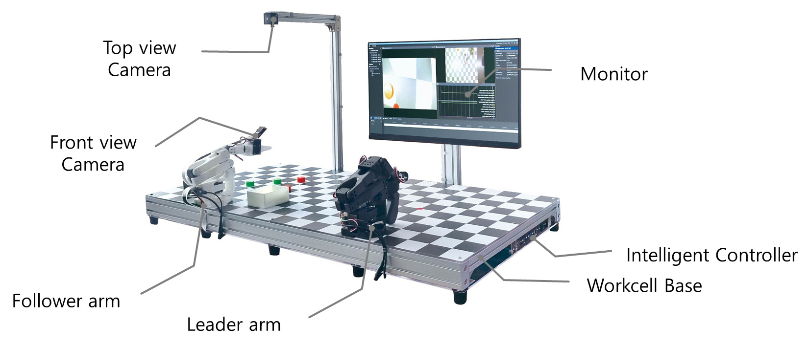

PhysicAI Arm을 시작하기 위해선 전원 케이블을 연결한 후, 전원을 켜야 합니다. 본 제품의 측면을 보시면 포트들과 전원 버튼이 있는 것을 확인할 수 있습니다. 

- 1️⃣ 전원 케이블 연결 : 전원 케이블을 연결하는 포트
- 2️⃣ 전원 스위치 : 0은 OFF, 1은 ON
- 3️⃣ 이더넷 연결 : 유선 인터넷을 연결할 때 사용하는 포트
- 4️⃣ USB 연결 포트 : 키보드, 마우스, 조이스틱 등 USB를 이용한 케이블들을 연결
- 5️⃣ 초기화 스위치 : 리커버리 모드로 들어가기 위한 스위치, **일반적인 초기화가 아닌 전체 OS 초기화**
- 6️⃣ HOST 케이블 포트 : 리커버리 모드를 사용하기 위한 포트


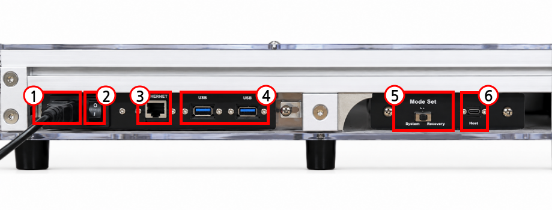

> [!CAUTION]
> 리커버리 모드는 단순히 파일만 초기화하는 것이 아닌, 전체 OS를 초기화하는 모드로 사용할 때 각별한 주의가 필요합니다.

노머신으로 원격 접속을 할 경우, 원격 접속할 PC와 PhysicAI Arm이 같은 네트워크에 연결되어 있어야 합니다.

와이파이 연결 명령어는 아래와 같습니다.

```sh
nmcli device wifi list # 주변 와이파이 목록
nmcli device wifi connect "WIFI-ID" password "WIFI-PW" # 와이파이 접속
nmcli connection show # 저장된 목록
```

### Visual Studio Code

Visual Studio Code(이하 VSCode)와 같은 프로그램을 통해 사용할 수 있습니다. 본 장비에는 VSCode가 이미 설치되어 있습니다. 화면에 우클릭을 해서 터미널, 파일 탐색기 등을 열 수 있습니다. 터미널을 통해 'code'를 입력하여 VSCode를 열 수 있습니다. 또한 'Development' 메뉴에서 VSCode를 클릭하여 열 수도 있습니다.
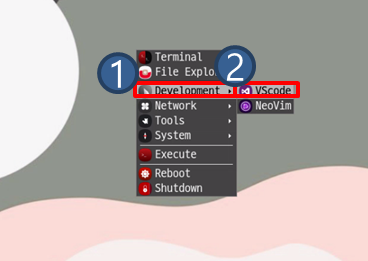

VSCode를 설치한 뒤에는 아래와 같은 화면이 표시되고 좌측 첫번째 메뉴 또는 상단의 'File'을 통해 파일을 불러올 수 있습니다. 'Open Folder'를 클릭하면 파일 탐색기가 나오고, `/home/soda` 경로의 폴더를 열어주면 됩니다.

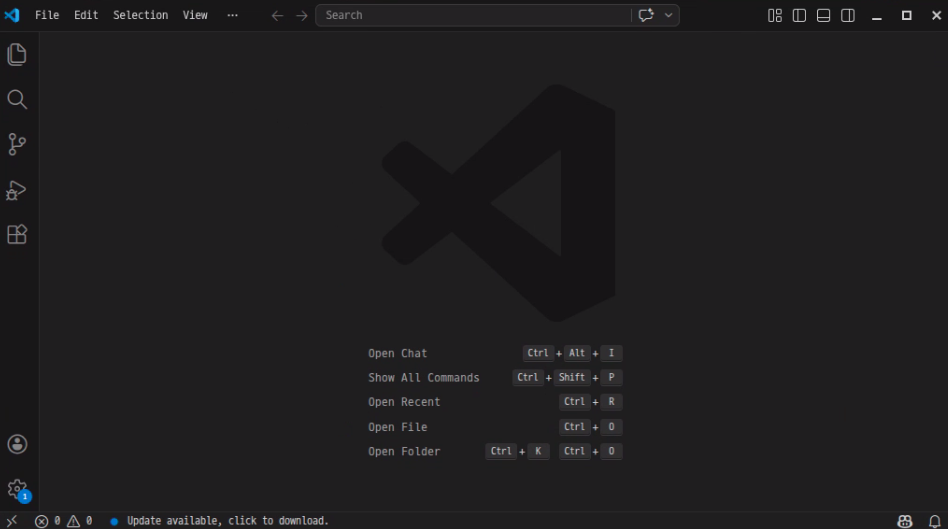

## Intelligent Controller

본 제품에 탑재된 지능형 로봇 제어기는 **Jetson Orin NX** 입니다. 본 지능형 로봇 제어기는 아래와 같은 하드웨어 성능을 보유하고 있습니다. 

| Type | Spec |
| ---- | ---- |
| GPU | NVIDIA Ampere GPU (1024 CUDA Cores + 32 Tensor Cores) |
| CPU | Arm Cortex v8 64-bit |
| Memory | 16GB LPDDR5 |
| Storage (external SSD) | 256GB |

지능형 로봇 제어기에 탑재된 OS 버전은 *Jetson Linux 36.3.0* 버전이며, 자사의 추가 설정으로 아래 모듈 및 소프트웨어가 탑재되어 있습니다.

| Name | Version |
| ---- | ------- | 
| Linux Kernel | 5.15.136-tegra |
| ROS2 | Humble (Source build) |
| Python | 3.10.12 |
| OpenCV | 4.10.0 (cuda, gstreamer) |
| Gazebo | Fortress |
| xpad | 0.4 |
| numpy | 1.26.1 |
| torch | 2.4.0a0+3bcc3cddb5.nv24.07 |

6장, 7장의 일부를 제외한 모든 실습 및 예제는 아래 환경에서 동작합니다. 상단에 기재된 소프트웨어 버전을 **임의로 업그레이드하거나 다운그레이드**할 경우 실습이 **원활히 진행되지 않을 수 있습니다.** 반드시 이 점 숙지해 주시기 바랍니다. 


## PhysicAI Arm 모델링 정보

PhysicAI Arm 장비에서 각 좌표계 및 위치, 방위 연산을 하기 위해선 로봇 모델링 파일이 필요합니다. PhysicAI Arm의 각 링크 및 조인트의 정보는 아래와 같습니다.

**Link**

| Name | length (mm) |
| ---- | ----------- |
| base_link | 46.84 |
| shoulder_link | 79.38 |
| upper_arm_link | 116.09 |
| lower_arm_link | 134.37 |
| wrist_link | 58.17 |
| gripper_link | 33.49 |

**Joint**

모든 조인트는 Revolute Joint 입니다. 

| Name | Range (θ) | axis xyz |
| ---- | ----------- | ----- |
| shoulder_pan | -1.92 ~ 1.92 | x / y / yaw |
| shoulder_lift | -1.75 ~ 1.75 | y / z / pitch |
| elbow_flex | -1.69 ~ 1.69 | y / z / pitch |
| wrist_flex | -1.66 ~ 1.66 | y / z / pitch |
| wrist_roll | -2.74 ~ 2.74 | roll |
| gripper | -0.17 ~ 1.75 | - |

위 정보들을 바탕으로 URDF를 작성하여 로봇 모델링 파일을 만들고 TF를 발행할 수 있습니다. 원활한 실습 진행을 위하여 모델링 진행 및 TF 발행, 그리고 다음 챕터에서 소개할 제어 토픽까지 모두 포함된 PhysicAI Arm 제어 패키지를 제공합니다.

다음 명령어를 통해 다운로드 및 설치를 진행합니다. 본 매뉴얼에서는 커스텀 워크스페이스 'physicai_arm_ws' 를 사용하는 것으로 가정합니다.

먼저 ros2 환경 설정을 위해 ros2_base를 소싱합니다. 이 과정을 통해 ros2가 ros2_base 안에 있는 패키지들을 알게됩니다. 

```sh
source ~/ros2_base/install/local_setup.zsh
```

환경설정을 한 뒤, 사용할 패키지들을 불러올 폴더를 만들고 만든 폴더로 이동합니다. 

```sh
mkdir -p ~/physicai_arm_ws/src
cd ~/physicai_arm_ws/src
```

만든 폴더 안에서 패키지를 불러옵니다. 일반적으로 ROS2에서는 패키지를 직접 생성한 뒤 노드와 실행 파일을 구현해야합니다. 하지만 개발 환경 구축 시간을 줄이고 실습의 편의성을 위해 PhysicAI Arm에 필요한 ROS2 패키지를 사전에 구성하여 Github 저장소로 제공하였습니다. 해당 패키지를 다운로드한 후 바로 실습 및 기능 개발을 진행할 수 있습니다.

```sh
git clone https://github.com/hanback-lab/PhysicAI-Arm-ROS physicai_arm
```

launch 파일 권한 문제 발생 시, 아래 명령어 실행

```sh
cd physicai_arm
chmod +x launch/*.launch.py
```

```sh
cd ~/physicai_arm_ws
colcon build --symlink-install --packages-select physicai_arm
```

## 패키지 실행 정보

### 공통 실행

프로그램 실행 전 새 터미널에서 아래 명령어를 실행하여 ROS 2 환경을 설정해야 합니다. 최초 빌드 시에는 `source ~/ros2_base/install/local_setup.zsh`를 통해 `ros2_base` 환경을 먼저 불러와야 하지만, 빌드가 완료된 이후에는 해당 정보가 워크스페이스에 반영되므로 새 터미널에서는 아래 명령어만 실행하면 됩니다.

```zsh 
cd ~/physicai_arm_ws
source install/setup.zsh
```

### Activate manipulator + camera + TF2

장비 매니퓰레이터의 모터 활성화 및 카메라 이미지, TF2 토픽 발행을 동시에 진행하는 방법은 아래와 같습니다. 토픽 출력이나 노드 실행을 중지하고 싶다면 `Ctrl+C`키를 누르면 정상적으로 종료됩니다.

```sh
ros2 launch physicai_arm bringup.launch.py
```

발행 및 구독하는 토픽 정보는 아래와 같습니다.

| 토픽 | Pub/Sub | 메시지 타입 | 설명 | 
| --- | ------- | -------- | ---- |
| /arm/front_cam, /arm/top_cam | Pub | `sensor_msgs/Image` | 장비에 부착된 각각 두 카메라의 이미지를 발행합니다.|
| /follower/joint_states | Pub | `sensor_msgs/JointState` | 매니퓰레이터의 현재 관절각을 발행합니다. |
| /follower/joint_targets | Sub | `sensor_msgs/JointState` | 매니퓰레이터의 목표 관절각을 설정하고 싶을 경우 이 토픽에 메시지를 발행합니다.
| /tf | Pub | `tf2_msgs/TFMessage` | 매니퓰레이터의 TF2 메시지를 발행합니다.|
| /safety/torque_enable | Sub | `std_msgs/Bool` | 매니퓰레이터의 모터 토크 설정을 활성화/비활성화 시킵니다. 비활성화 시킬 경우 모터에 부여된 토크값이 해제되어 손 등을 이용해 외부의 물리적인 요인을 통해 매니퓰레이터의 자세를 임의로 변경시킬 수 있습니다. |

/follower/joint_states 토픽 출력 예시입니다.

```sh
ros2 topic echo /follower/joint_states
```


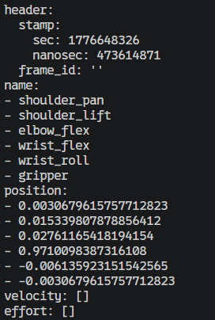


### Teleoperataion

본 제품에는 Follower Arm과 Leader Arm으로 구성된 매니퓰레이터가 각각 한 개씩 있습니다.Leader Arm(검은 팔)을 이용하여 Follower Arm(하얀 팔)을 제어할 수 있습니다. 명령어는 아래와 같습니다. teleoperation 명령어는 Leader Arm을 사용해 Follower Arm을 제어할 때 사용됩니다.

teleoperation을 실행하면 Leader Arm과 같은 자세를 위해 급격하게 움직이다 파손될 수 있으므로 최대한 비슷한 자세를 맞춰준 뒤 실행하는 것을 권장합니다.

```sh
ros2 run physicai_arm teleoperation
```

teleoperation을 실행한 뒤, 위 토픽들을 출력해보면 실시간으로 값이 바뀌는 것을 확인할 수 있습니다.

추후 Imitation Learning을 수행할 때, teleoperation 기능을 활용하여 학습을 위한 데이터를 수집할 수 있습니다.


### FK Calculate

```sh
ros2 run physicai_arm fk_calc
```

EE 위치를 모니터링하는 패키지입니다. `bringup.launch.py` 를 실행한 후 진행해야 합니다. 

발행 및 구독하는 토픽은 아래와 같습니다.

| 토픽 | Pub/Sub | 메시지 타입 | 설명 | 
| --- | ------- | -------- | ---- |
| /ee_pose | Pub | `geometry_msgs/PoseStamped` | EE의 위치 및 방위(Quaternion) 값을 발행합니다. |

/ee_pose 의 토픽 출력 예시입니다.

```sh
ros2 topic echo /ee_pose
```

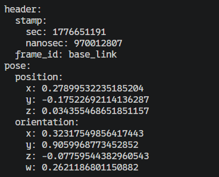

### IK Calculate

```sh
ros2 run physicai_arm ik_calc
```

임의의 EE 위치 및 방위 값을 받아 로봇을 동작시킵니다. 

발행 및 구독하는 토픽은 아래와 같습니다.

| 토픽 | Pub/Sub | 메시지 타입 | 설명 | 
| --- | ------- | -------- | ---- |
| /target_pose | Sub | `geometry_msgs/PoseStamped` | 임의의 EE 위치 및 방위 값을 받습니다. |
|/follower/joint_states|Sub| `sensor_msgs/JointState`|현재 관절 각도를 받습니다. |
|/gripper_open|Sub|`std_msgs/Bool`| 그리퍼 개폐 명령을 받습니다.|
|/follower/joint_targets|Pub|`sensor_msgs/JointState`|IK 계산 결과 관절 목표값을 발행합니다.|

/follower/joint_targets 의 토픽 출력 예시입니다.


```sh
ros2 topic echo /follower/joint_targets
```

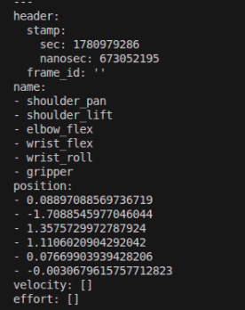

## Run Gazebo


```sh
ros2 launch physicai_arm sim_bridge.launch.py world_sdf:=/home/soda/physicai_arm_ws/src/physicai_arm/world/ex_sim.sdf
```

Gazebo 시뮬레이션을 실행하며, 자동으로 PhysicAI Arm 로봇 모델 SDF 파일을 불러옵니다. 단, 패키지 내 `world/ex_sim.sdf` 파일 형식과 같이 `physicai_arm` 을 include 하는 태그가 반드시 존재하여야 합니다.

아래는 로봇 모델 포함 및 배치 예시입니다.

```xml
    <include>
      <uri>model://physicai_arm_so101</uri>
      <name>physicai_arm</name>
      <pose>0 0 0 0 0 0</pose>
    </include>
```

발행 및 구독하는 토픽은 아래와 같습니다.

| 토픽 | Pub/Sub | 메시지 타입 | 설명 | 
| --- | ------- | -------- | ---- |
| /follower/joint_states | Pub | `sensor_msgs/JointState` | 시뮬레이션 상에 배치된 매니퓰레이터 관절각을 발행합니다. |
| /follower/joint_targets | Sub | `sensor_msgs/JointState` | 시뮬레이션 상에 배치된 매니퓰레이터 관절각 상태를 지정합니다. |
| /sim/elbow_flex/cmd_pos | Sub | `std_msgs/Float64` | elbow_flex 조인트에 배치된 Ignition Gazebo JointPositionController 에 관절각 상태를 지정합니다. |
| /sim/gripper/cmd_pos | Sub | `std_msgs/Float64` | gripper 조인트에 배치된 Ignition Gazebo JointPositionController 에 관절각 상태를 지정합니다. |
| /sim/shoulder_lift/cmd_pos | Sub | `std_msgs/Float64` | shoulder_lift 조인트에 배치된 Ignition Gazebo JointPositionController 에 관절각 상태를 지정합니다. |
| /sim/shoulder_pan/cmd_pos | Sub | `std_msgs/Float64` | shoulder_pan 조인트에 배치된 Ignition Gazebo JointPositionController 에 관절각 상태를 지정합니다. |
| /sim/wrist_flex/cmd_pos | Sub | `std_msgs/Float64` | wrist_flex 조인트에 배치된 Ignition Gazebo JointPositionController 에 관절각 상태를 지정합니다. |
| /sim/wrist_roll/cmd_pos | Sub | `std_msgs/Float64` | wrist_roll 조인트에 배치된 Ignition Gazebo JointPositionController 에 관절각 상태를 지정합니다. |

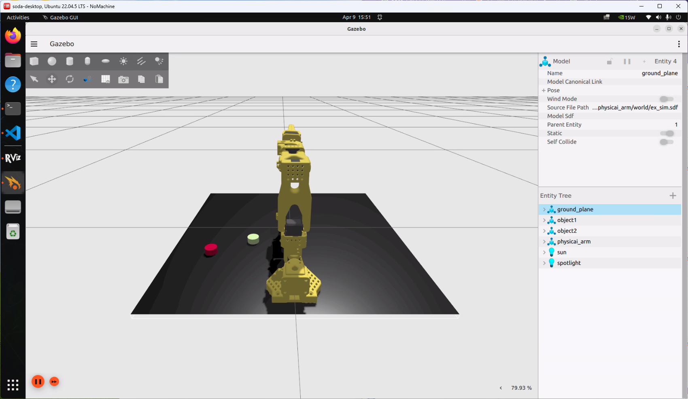<br>

Gazebo를 실행한 뒤, teleoperation을 실행하면 Gazebo에 있는 로봇팔이 실제와 똑같이 움직이는 것을 확인하실 수 있습니다.

## RVIZ
카메라에서 발행되는 이미지를 확인하기 위해 RViz를 이용하여 시각화를 수행합니다.

1. RViz 실행
새 터미널을 열고 ROS2 환경을 설정한 후, 아래 명령어를 통해 RViz를 실행합니다.
```
ros2 run rviz2 rviz2
```

2. Image 디스플레이 추가
RViz가 실행되면 좌측 하단의 Add 버튼을 클릭하여 디스플레이를 추가합니다. 창이 뜨면 Image를 선택한 후 OK를 누르면 됩니다.

실행됐을 때 나오는 Robot Model Status Error는 로봇 제어 패키지를 먼저 launch하지 않은 상태에서 RViz2 실행하면 발생하는 오류입니다. 현재는 카메라 이미지만 확인하는 상황이라 이 에러는 무시하도록 하겠습니다.

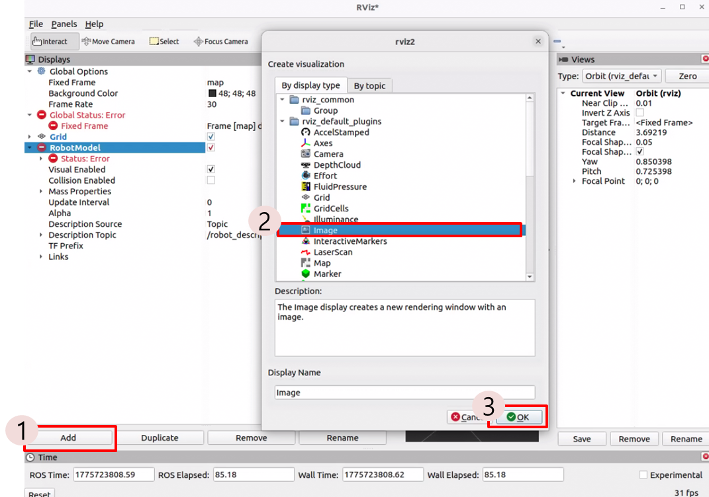

Displays 메뉴창에서 Image를 찾아 누른 뒤, Topic에서 '/arm/front_cam'과 '/arm/top_cam' 중 원하는 카메라 위치를 찾아 선택합니다.

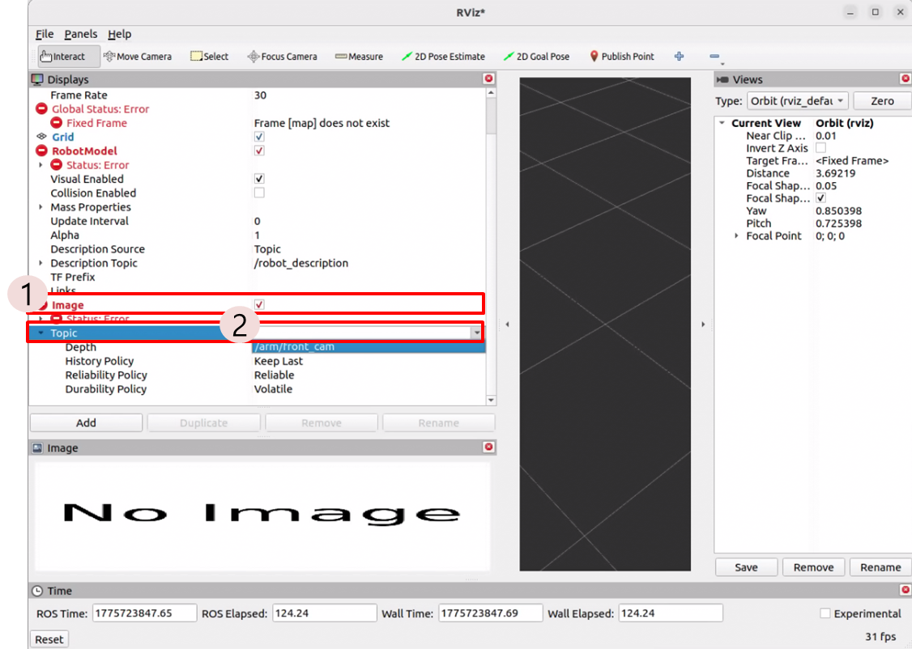

토픽을 선택한 뒤, 엔터를 눌러 적용시켜 줍니다. 

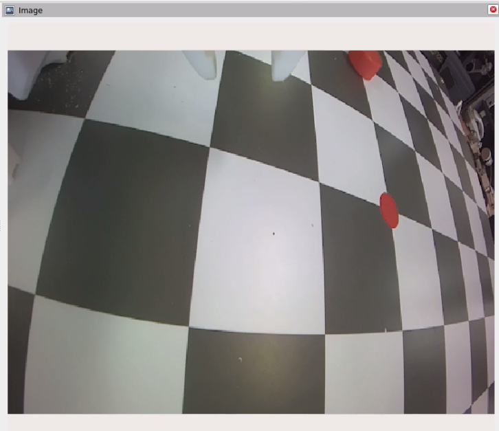

## OpenCV

OpenCV(Open Source Computer Vision Library)는 영상 처리 및 이미지 분석을 위한 오픈소스 라이브러리입니다. RViz는 ROS2 데이터를 시각적으로 보여주는 도구라면, OpenCV는 카메라 영상을 분석하여 색상 인식, 객체 검출, 영상 필터링 등을 수행합니다. 본 제품은 OpenCV를 비롯한 주요 라이브러리들이 사전에 빌드되어 있어 pip 등 명령어를 사용하여 패키지를 추가하거나 업데이트할 필요 없습니다. 임의로 변경하게 될 시, 의존성이 충돌하여 개발 환경이 손상될 수 있으니 주의해주세요.

OpenCV 라이브러리를 활용하여 Camera Calibration을 수행할 수 있습니다. Camera Calibration은 렌즈 왜곡으로 인한 카메라 이미지를 보정하는 과정입니다. Imitation Learning에서 품질 좋은 카메라 이미지 데이터를 수집하기 위해 진행됩니다.

OpenCV에서는 주로 체크보드를 사용하여 Calibration을 진행합니다. 9X7 형태의 체커보드를 준비한 뒤 Calibration을 수행하면 됩니다.

공개된 교재에서 8, 9, 10장은 Imitation Learning 부분으로 프로젝트 형식으로 진행됩니다. 해당 프로젝트의 `parsing_node`와 `inference_node`는 Calibration 결과 json 파일을 **선택적으로** 사용합니다. 설정한 경로에 파일이 있으면 fisheye 왜곡 보정을 적용하고, 파일이 없으면 보정 없이 그대로 진행합니다. 보정을 적용할 경우 학습(`parsing_node`)과 추론(`inference_node`) 양쪽에 **같은 json 파일**을 지정해야 하므로, Calibration을 수행했다면 저장해둔 경로를 기억해두시기 바랍니다.

## Imitation Learning 노드 (`etc/`)

8, 9, 10장 프로젝트에서 사용하는 노드 3종의 스크립트가 `etc/` 폴더에 포함되어 있습니다. 실습 환경에 맞게 아래 표의 플레이스홀더(`<...>`) 값을 수정한 뒤 패키지에 추가하고, `setup.py`의 `entry_points`에 등록해 빌드합니다.

| 파일 | 역할 | 주요 토픽 |
| --- | --- | --- |
| `logger_node.py` | 에피소드별 원시 데이터(카메라 이미지, 관절 상태/목표값) 저장 | Sub: `/arm/front_cam`, `/arm/top_cam`, `/follower/joint_states`, `/follower/joint_targets`, `/ee_pose` |
| `parsing_node.py` | 원시 데이터를 LeRobot 데이터셋으로 변환 후 Hugging Face Hub 업로드 | - |
| `inference_node.py` | 학습된 ACT policy로 실시간 추론 및 제어 | Sub: `/arm/top_cam`, `/arm/front_cam`, `/follower/joint_states` / Pub: `/follower/joint_targets` / Service: `/inference/reset` |

**수정해야 하는 값**

| 노드 | 항목 | 플레이스홀더 | 설명 |
| --- | --- | --- | --- |
| logger | `save_dir` | `<dir_name>` | 원시 데이터를 저장할 폴더 |
| logger | `task_name` | `<task_name>` | 에피소드 metadata에 기록할 작업 이름 |
| parsing | `RAW_ROOT` | `<raw_data_dir_name>` | 로거가 저장한 원시 데이터 폴더 (logger의 `save_dir`와 동일) |
| parsing | `OUT_REPO_ID` | `<hf_username>/<dataset_repo_name>` | 변환 결과를 올릴 Hugging Face 데이터셋 저장소 |
| parsing | `TASK_DEFAULT` | `<task_name>` | metadata에 task가 없을 때 사용할 기본 작업 이름 |
| parsing | `CALIB_PATH` | `<calibration_json_path>` | Calibration json 경로 (선택) |
| inference | `policy_path` | `<user_name>/<policy_path>` | 불러올 정책 경로 (Hugging Face 저장소 또는 로컬 경로) |
| inference | `calib_path` (`CALIB_PATH`) | `<calibration_json_path>` | Calibration json 경로 (선택, parsing과 동일 파일) |

**Calibration json 형식**

`parsing_node`와 `inference_node`가 동일한 형식을 사용합니다. top/front에 공통으로 적용하거나 카메라별로 나눠 줄 수 있습니다.

```json
// (A) 공용: top/front 모두 동일 적용
{ "K": [[fx,0,cx],[0,fy,cy],[0,0,1]], "D": [k1,k2,k3,k4], "balance": 0.0 }

// (B) 카메라별
{ "top": { "K": [...], "D": [...] }, "front": { "K": [...], "D": [...] } }
```

`balance`는 생략 시 `0.0`입니다. 왜곡 보정은 이미지를 학습 입력 크기(128x128)로 줄이기 전 원본 해상도에서 fisheye 모델로 적용되며, 보정 맵은 카메라·해상도별로 최초 1회만 계산해 재사용합니다.